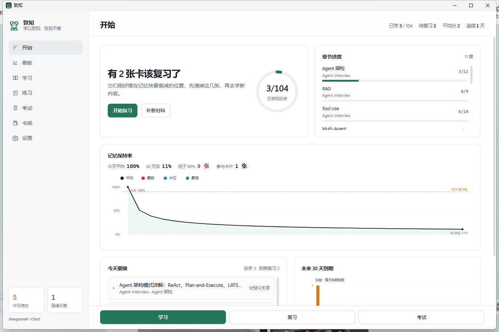
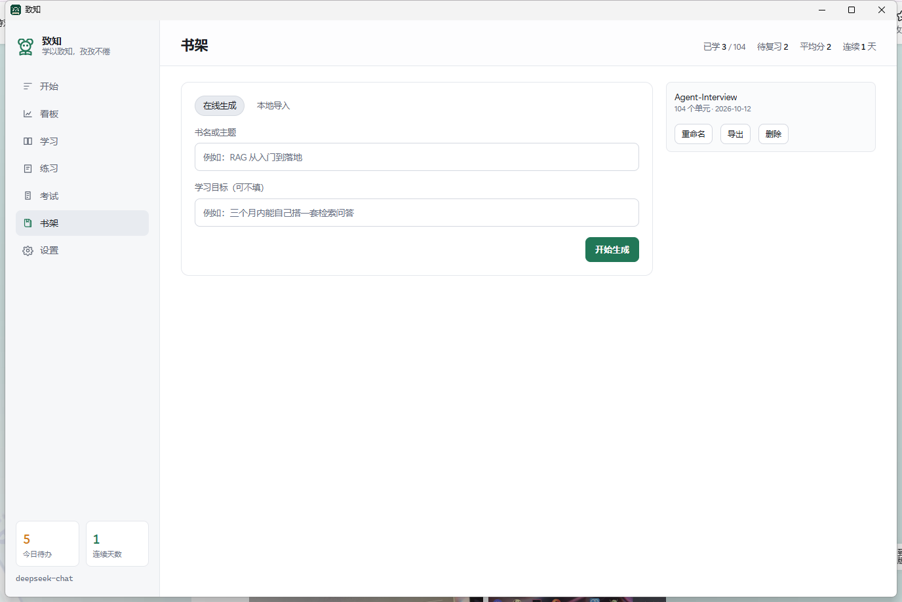
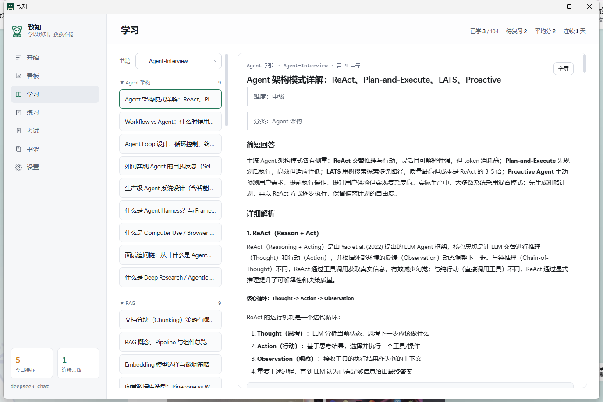
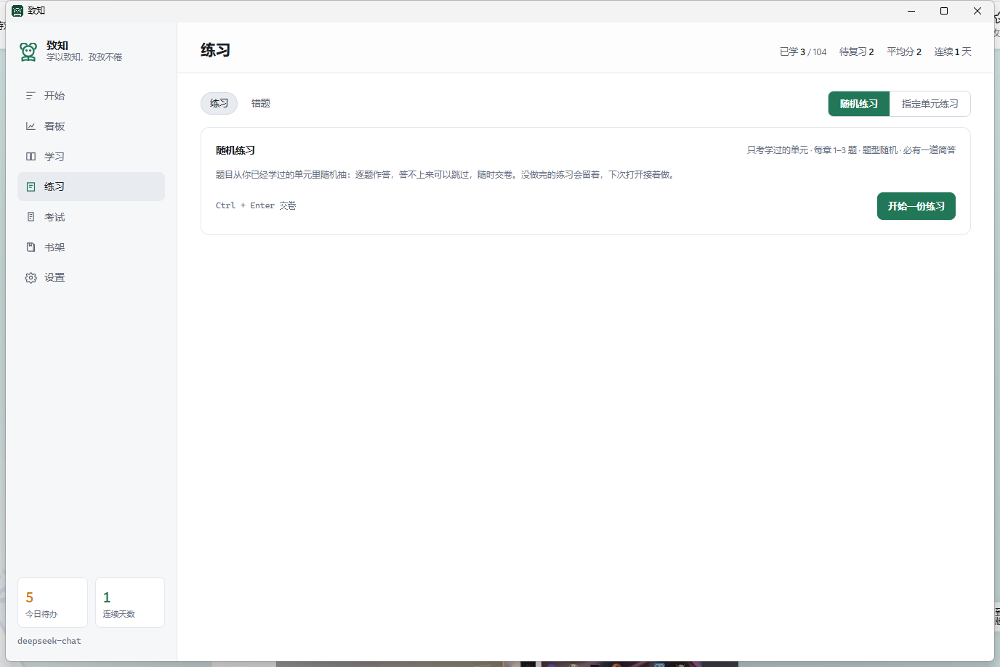
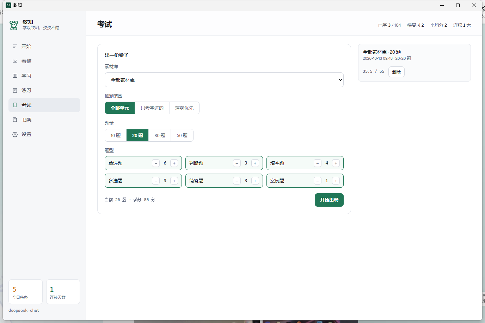
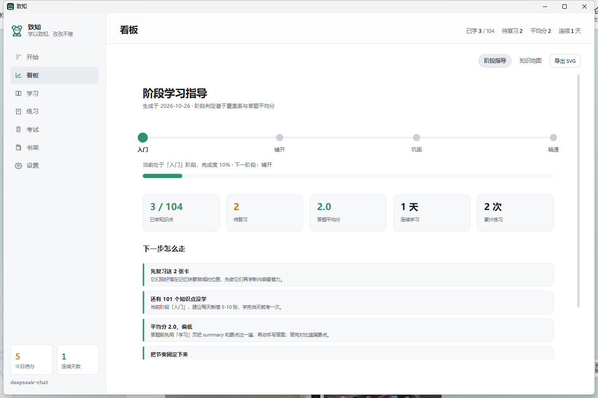

# 致知 · zhizhiStudy

> 把一份资料变成一套能每天照着学的课程：导入、拆知识点、写书、练习、考试、按记忆曲线排复习，全在一个窗口里。

## 简介

学一门新东西，难的往往不是找资料，而是资料到手之后怎么办：读完了记不住，记住了又不知道什么时候该再看一遍。

致知把这条链路做成一件事：给它一个链接、一份 PDF / Word、一段粘贴的文字，或者干脆只给一个主题，它会整理成材料、拆成一条条知识单元，每条配讲解、要点和自测题；学完随手考一次，好在哪里、漏了什么当场就知道，下一次该复习哪些内容自动排好。想要一份成体系的读物，就让它在书架上直接生成一本有目录、有章节的书。

下载即可使用，界面七个页面，第一次打开也能直接上手。

## 界面

<table>
  <tr>
    <td width="50%"> 开始：今天该复习哪几张、待办清单、记忆保持率与未来 30 天到期量</td>
    <td width="50%"> 书架：在线生成一本书，或本地导入材料，一行就是一份可学的内容</td>
  </tr>
  <tr>
    <td> 学习：顶部按书切换，逐单元读讲解，划词翻译与提问</td>
    <td> 练习：随机出题或指定单元作答，判分后自动排复习；错题可展开</td>
  </tr>
  <tr>
    <td> 考试：六种题型自动组卷，左边作答、右边考试记录</td>
    <td> 看板：阶段指导与知识地图，可导出 SVG</td>
  </tr>
</table>

| 页面 | 做什么 |
|---|---|
| 开始 | 今天该复习哪几张、今日待办、记忆保持率与未来 30 天到期量 |
| 书架 | 在线生成一本书，或本地导入材料；书架里一行就是一份可学的内容 |
| 学习 | 按书筛选，逐单元读正文；划词翻译、划词提问；已学单元折叠可重读 |
| 练习 | 随机练习（每章 1–3 题）与指定单元练习：作答、判分、自动排期；错题可展开看答案 |
| 考试 | 六种题型自动组卷，软件内作答，交卷出分与复习要点 |
| 看板 | 阶段指导、知识地图，可导出 SVG |
| 设置 | 模型接口、网络代理、每日提醒、开机自启、划词功能开关 |

## 功能

- **四种取料方式**：网页链接、一个主题（自动搜索合并）、本地文件（PDF / Word / Markdown / 纯文本）、直接粘贴
- **自动拆解**：整理成一条条知识单元，每条带讲解、要点与自测题；考点可分批补生成，失败有原因
- **书架即内容**：在线生成会排目录、逐章写正文，成书后直接出现在书架；书和材料是同一种东西，点一行就进学习页读书或读单元
- **学习页**：按书筛选、搜索单元、只看已学、已学折叠；正文支持表格、代码块与 Mermaid 流程图
- **划词两件套**：选中文字就地翻译；选中段落直接提问，白话回答 + 3 条追问，可切「认真想想」
- **练习**：随机出题按章节铺开，作答后模型判分并自动排期；作答前不给任何提示，交卷后才看遗漏、参考回答与考试里错过的点
- **错题**：卡片式列出题型、题目、当时得分、所属书与单元、做题日期；点开看答案，可删除
- **考试**：六种题型自动组卷，客观题本地判分、主观题按点给分，交卷后汇总复习要点并写回知识点
- **定时复习**：按 FSRS 记忆曲线安排每天该复习的内容，到点提醒
- **看板**：阶段判定、知识地图与行动建议，可导出图片贴进文档

## 快速开始

到 [Releases](https://github.com/wenbuer/zhizhiStudy/releases) 下载 `Zhizhi.exe`，双击运行，无需安装。

首次使用在「设置」页填写三项，保存后立刻可用：

| 字段 | 示例 |
|---|---|
| API 地址 | `https://api.deepseek.com/v1` |
| API Key | 你自己的 Key |
| 模型名 | `deepseek-chat` |

没有填写也能打开软件：材料可以导入整理，学习与看板都能用，只是自动出题、判分与成书不可用，界面会说明原因。

### 首次运行被拦截怎么办

程序没有代码签名证书，从浏览器下载后 Windows 会弹「Windows 已保护你的电脑」。两种处理方式，任选其一：

1. 弹窗里点「更多信息」→「仍要运行」；
2. 或者右键 `Zhizhi.exe` → 属性 → 勾选「解除锁定」→ 确定，之后双击即可直接运行。

也可以在 PowerShell 里执行 `Unblock-File .\Zhizhi.exe`（解除锁定后会去掉下载标记，不再提示）。

## 复习怎么排

每次作答后，软件按 FSRS 算出这张卡下次该复习的日期：答得越好间隔拉得越久，答错或没把握很快就再见到它。每天只需要清掉当天该做的部分，不必自己规划。测验不改排期，避免把复习节奏冲乱。

## 数据

所有内容都存在本机，卸载或删除软件不影响已学记录。数据目录为 `%APPDATA%\com.zhizhi.desktop\`，删除其中的 `zhizhi.db` 即可从零开始。

## 从源码构建

需要 Rust 工具链（MSVC 目标）。

    cargo run --manifest-path src-tauri/Cargo.toml            # 开发运行
    cargo build --release --manifest-path src-tauri/Cargo.toml # 生成可执行文件
    cargo test --manifest-path src-tauri/Cargo.toml            # 单元测试

## 许可

MIT，见 [LICENSE](LICENSE)。
